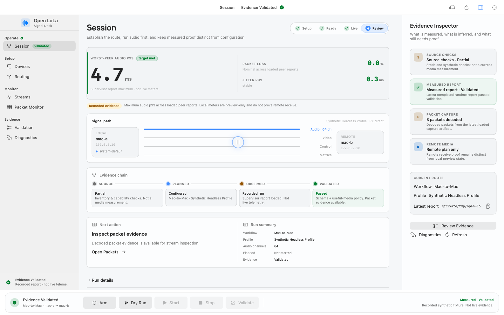
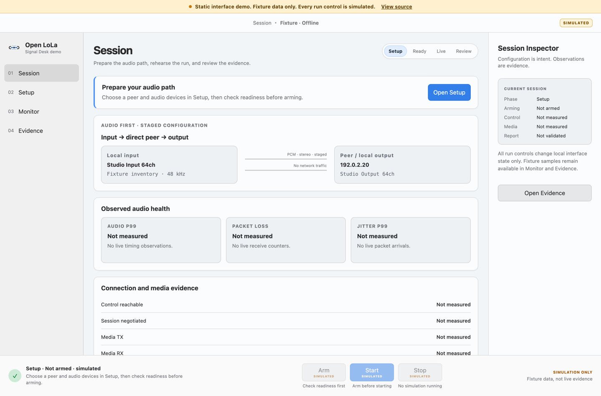
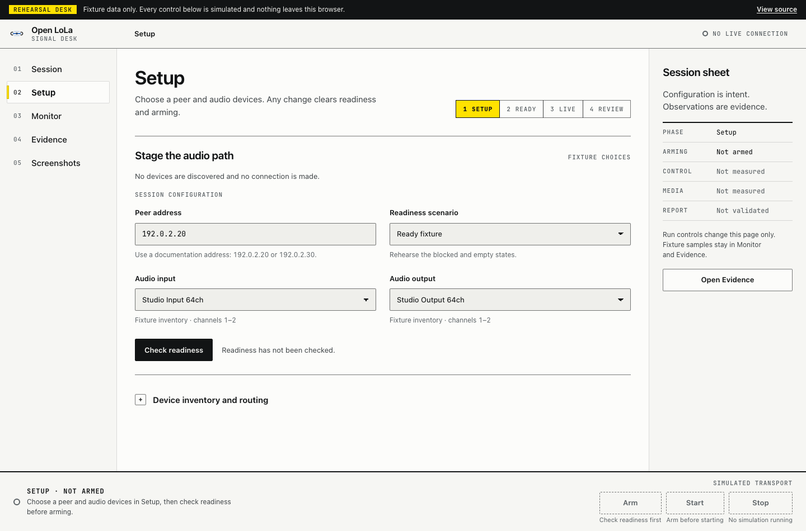
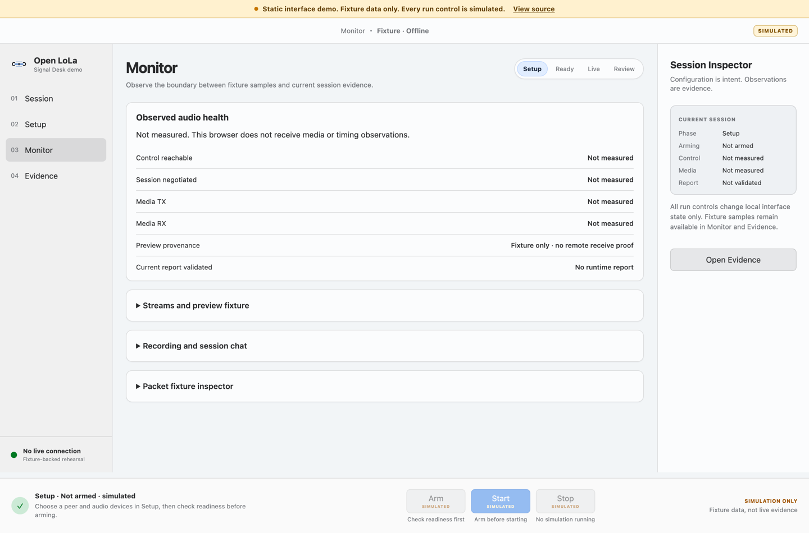
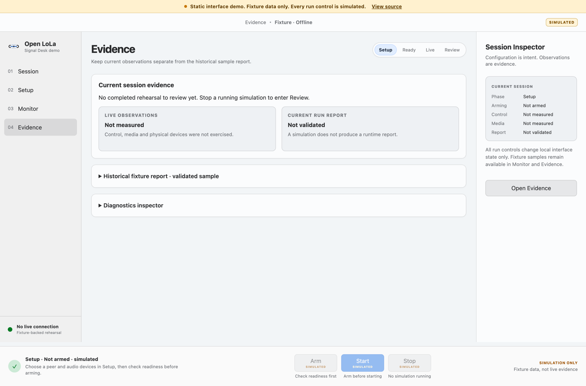

<div align="center">

<picture>
  <source media="(prefers-color-scheme: dark)" srcset=".github/assets/open-lola-mark-dark.svg">
  
</picture>

# Open LoLa

**An independent, experimental project for configuring, running, and measuring low-latency audio and video sessions.**

[](https://github.com/sebastianspicker/open-lola/actions/workflows/tests.yml)
[](https://github.com/sebastianspicker/open-lola/actions/workflows/release-readiness.yml)


[](LICENSE)

</div>

Open LoLa has two runtimes: a native **macOS app and CLI**, and a **Rust station**
for Windows and Linux. They share protocol test fixtures but no runtime code.
Python is used only for repository tooling.

> Open LoLa is not affiliated with or endorsed by the LoLa project,
> Conservatorio di Musica Giuseppe Tartini, or GARR.

## Screenshot tour

The Signal Desk is the macOS operator window. It shows configuration, measured
values, and report validation in separate areas, so a synthetic or local run is
not confused with a field measurement.

<picture>
  <source media="(prefers-color-scheme: dark)" srcset=".github/assets/open-lola-signal-desk-dark.png">
  
</picture>

*Offline render of the real SwiftUI views with synthetic data. It is not a live
measurement.*

The app has four workspaces:

| Workspace | What it is for |
|---|---|
| **Session** | Arm and run a session, and follow its progress |
| **Setup** | Devices, routing, and the direct-peer connection |
| **Monitor** | Streams, packet fixtures, and local preview |
| **Evidence** | Report validation and diagnostics |

The browser demo in [web/demo](web/demo) shows the same four workspaces with
fixture data, not live hardware:

<p align="center">
  
  
</p>
<p align="center">
  
  
</p>

To try it, open [web/demo](web/demo) in any browser (see the quick start for a
local server). It only changes page state: it does not discover devices, use the
network, or run native code.

## Status

Open LoLa is a source alpha, and its overall verdict is `PARTIAL`. Local builds,
tests, loopback runs, synthetic reports, and offline renders do not prove
physical latency, device compatibility, interoperability with a reference peer,
or safety on hostile networks. Nothing is signed, notarized, or distributed.
[Current state](docs/current-state.md) lists what has and has not been shown.

## Components

| Path | Purpose | Technology | How it is used | Documentation |
|---|---|---|---|---|
| `runtimes/macos/` | Operator app, CLI, direct-peer sessions, media adapters, integrations, and reports | SwiftPM, SwiftUI, AppKit, Core Audio, AVFoundation | Built and run on macOS 14 or later | [Architecture](docs/architecture.md) |
| `runtimes/rust-station/` | Windows and Linux LoLa 2.0 station with native and diagnostic backends | Rust, egui, ALSA, V4L2, PortAudio, XIMEA, Npcap | Cargo package and `rusty-lola` executable | [Rust station](runtimes/rust-station/README.md) |
| `interop/lola2/` | Versioned synthetic wire corpus shared by both runtimes | JSON | Read by the Rust and macOS corpus tests (test sources are not published) | [Corpus](interop/lola2/README.md) |
| `web/demo/` | Fixture-backed Signal Desk walkthrough | Static HTML, CSS, JavaScript | Served by any static file server | This README |
| `tools/` | Checks, local packaging, release export, and interoperability helpers | Shell, Python, Swift, PowerShell | Run from the repository root | [Tool index](tools/README.md) |
| `third_party/` | Vendored Opus and JPEG XS source | C/C++ and upstream support files | Opus is always built; JPEG XS only in an opt-in build | [Third-party notices](THIRD_PARTY_NOTICES.md) |

[docs/architecture.md](docs/architecture.md) covers the macOS Swift targets,
runtime flows, and which module owns which state.

## Prerequisites

The full repository check runs on macOS and needs:

- Xcode 26.6 with Swift 6.3.3 or newer (CI uses this version; a newer Xcode is
  used when `/Applications/Xcode-26.6.0.app` or `/Applications/Xcode_26.6.app`
  is absent, see below);
- Python 3.14.6 for the pinned development environment (tooling supports 3.11
  and later);
- `uv` 0.10.7 or newer (CI pins 0.10.7);
- Rust 1.99.0 with Cargo, rustfmt, and Clippy (pinned in `rust-toolchain.toml`;
  rustup installs it automatically);
- `shellcheck`.

Testing the station's XIMEA, PortAudio/ASIO, Npcap, and native GUI support
needs Windows. Linux device testing targets Ubuntu 24.04 x86_64; see
[Linux migration and validation](docs/linux-migration.md).

## Quick start

Run all commands from the repository root.

```bash
uv sync --locked --extra dev
make architecture
```

`make` uses `/Applications/Xcode-26.6.0.app` or `/Applications/Xcode_26.6.app`
if present, otherwise the Xcode selected by `xcode-select -p`. Set
`DEVELOPER_DIR` to choose a different one.

Build the macOS package outside the checkout and try the CLI:

```bash
export DEVELOPER_DIR="${DEVELOPER_DIR:-$(xcode-select -p)}"
swift build --disable-sandbox \
  --scratch-path /private/tmp/open-lola-swiftpm-build
OPEN_LOLA_CLI="$(swift build --disable-sandbox \
  --scratch-path /private/tmp/open-lola-swiftpm-build \
  --show-bin-path)/open-lola"
"$OPEN_LOLA_CLI" --help
"$OPEN_LOLA_CLI" session-capabilities
```

`--help` lists the session commands first. [Running a session](docs/running-a-session.md)
has recipes for two Macs, a supervised run, and the Rust station. None of them
has been tested on hardware yet.

JPEG XS video compression is not in the default build. The vendored JPEG XS
reference code is licensed for evaluation and testing only and grants no patent
licence, so do not distribute binaries built with it. To include it for local
testing, set `OPEN_LOLA_ENABLE_JPEG_XS=1` when SwiftPM resolves the package, for
example `OPEN_LOLA_ENABLE_JPEG_XS=1 swift build ...`, and use a separate
`--scratch-path`. Without it, `--video-compression jpeg-xs` fails with a message
saying JPEG XS is not built in.

In a graphical macOS session, build and launch a local test app bundle
(ad-hoc signed, not for distribution):

```bash
OPEN_LOLA_APP_DIST_DIR=/private/tmp/open-lola-app-dist \
OPEN_LOLA_SWIFT_BUILD_PATH=/private/tmp/open-lola-swiftpm-build \
  bash tools/macos/build_and_run.sh run
```

Run the Rust station self-test with synthetic media on localhost, and show its
help:

```bash
cargo run -p rusty-lola --no-default-features -- selftest --duration 0.25
cargo run -p rusty-lola -- --help
```

Serve the browser demo:

```bash
python3 -m http.server 4173 --bind 127.0.0.1 --directory web/demo
```

## Configuration

The macOS app stores its settings in `UserDefaults`. The Rust station reads
settings and session files and lets CLI flags override them.
[docs/configuration.md](docs/configuration.md) covers precedence, storage, and
which inputs are trusted.

## Verification

Run the focused checks while you work:

```bash
make architecture
make code-quality
make test-python
make test-rust
make lint
```

Before a change that touches both runtimes or the release export, run:

```bash
make verify
```

`make verify` checks the source only. It always ends with a `PARTIAL` verdict and
does not approve a release. [docs/testing.md](docs/testing.md) lists the exact
commands, what CI covers, and the hardware checks still missing.

## Compatibility and security

Stable interfaces include the SwiftPM product and module names, both CLIs, the
report and settings formats, and the documented wire and corpus behavior. See
[docs/source-contracts.md](docs/source-contracts.md).

Control and media traffic is not authenticated. Use an isolated, trusted network
and executables you have reviewed. Read [SECURITY.md](SECURITY.md) before you run
a listener or use the process, DLL, SSH, or packet-capture integrations.

## Contributing and releases

Read [CONTRIBUTING.md](CONTRIBUTING.md) before you start.
[docs/RELEASING.md](docs/RELEASING.md) explains how a source candidate is
prepared. No command in this repository publishes a release.

First-party source and documentation are licensed under [Apache-2.0](LICENSE).
Vendored components keep their own licenses; see
[THIRD_PARTY_NOTICES.md](THIRD_PARTY_NOTICES.md) and [LEGAL.md](LEGAL.md).
