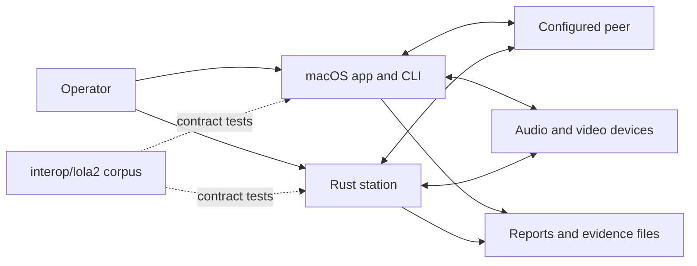
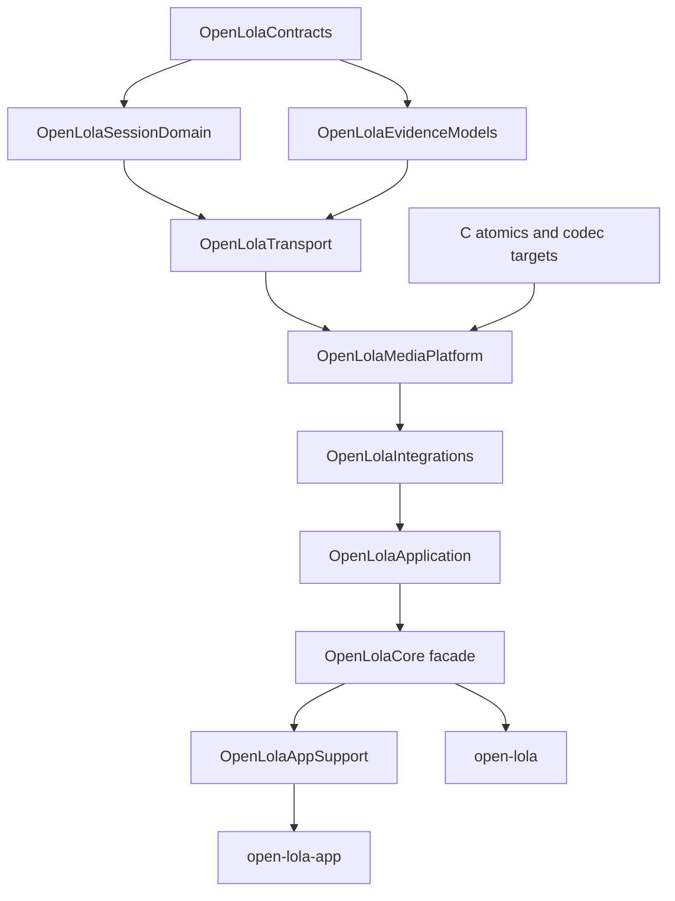

# Architecture

Open LoLa has two runtimes, a shared synthetic test corpus, vendored codecs, and
repository tooling. The runtimes share only documented protocols and files;
neither imports the other.

## System context

Reports record what happened; they are never read back as configuration.

`runtimes/macos` is the main operator runtime. `runtimes/rust-station` is the
Windows and native Linux station: PortAudio/ASIO with XIMEA or Media Foundation
(USB/UVC webcams) on Windows, ALSA and V4L2 on Linux. Python is for repository
tooling only. `interop/lola2` holds synthetic encoded and decoded cases with
provenance metadata; it is a regression suite, not a reference-peer capture.

## Repository layout

| Path | Contents | Built or run as |
|---|---|---|
| `Package.swift`, `runtimes/macos/` | macOS libraries, CLI, app, and Swift tests | SwiftPM package |
| `runtimes/rust-station/` | Station protocol, configuration, devices, transport, UI, and session lifecycle | Cargo package `rusty-lola` |
| `interop/lola2/` | Cross-language LoLa 2 compatibility cases | Versioned JSON corpus |
| `third_party/` | Upstream Opus and JPEG XS source | Selected C targets declared by SwiftPM |
| `tools/` | Verification, local bundle assembly, evidence helpers, and source export | Repository scripts |
| `web/demo/` | Fixture-backed interface walkthrough | Static files |

Build output, caches, captures, reports, local and private files, and
`archive/` are not part of the source or the release; see
`tools/release-boundary-policy.txt`.

## macOS target graph

SwiftPM enforces these target dependencies:

Arrows show the main layering. A target may also import any target below it; for
example, `OpenLolaApplication` imports all lower modules.

| Target | Contents |
|---|---|
| `OpenLolaContracts` | Shared vocabulary with no framework dependencies: verdicts, run modes, JSON coding, and the CLI key/value argument syntax |
| `OpenLolaSessionDomain` | Session policy with no side effects; depends only on contracts |
| `OpenLolaEvidenceModels` | Reusable reports and validators; depends only on contracts |
| `OpenLolaTransport` | Sockets, packet movement, NAT and network diagnostics, and transport policy. May use system networking and process APIs, but not UI or media frameworks |
| `OpenLolaMediaPlatform` | Device, realtime audio, video, camera permission, and codec adapters |
| `OpenLolaIntegrations` | Code that talks to external systems: LoLa, UltraGrid, JackTrip, and NMP connectors (`Connectors/`), ATEM, OSC and lighting show control (`Control/`), and the managed child-process runner (`Process/`). Cannot import `OpenLolaApplication` |
| `OpenLolaApplication` | Composition: CLI command bodies (`CLI/`), direct-peer session orchestration (`Session/`), media and benchmark runners (`Media/`, `IntegratedAV/`), reports and validators that span several domains (`Evidence/`), capability summaries, and the engine the SwiftUI app drives (`AppShell/`) |
| `OpenLolaCore` | Re-export facade and the stable public product. Internal modules can move behind it without changing consumer imports. The product also includes the C atomics and codec targets |
| `OpenLolaAppSupport` | SwiftUI/AppKit presentation (`Sources/OpenLolaAppSupport`) |
| `open-lola`, `open-lola-app` | Executable targets that do the final composition; each directory also holds its Info.plist and entitlements |

`tools/verify_architecture.py` checks the target graph, import allowlists, facade
shape, parser placement, and the main side-effect rules.

The media, evidence, and direct-peer folders in `OpenLolaApplication` depend on
each other (benchmark runners feed the validators; session runners reuse media
timing). They share a target on purpose, because splitting them would need
behaviour changes that current tests cannot protect. Put new connectors,
show-control protocols, and external processes in `OpenLolaIntegrations`, and
new commands or reports that combine several domains in `OpenLolaApplication`.

## macOS runtime flow

The app steps through configure, preflight, arm, run, monitor, and review. It
builds a validated execution plan from the operator's settings and starts the CLI
as a managed child process.

Before launch, the app writes a unique run token to a `session.token` file next
to the report. A run succeeds only if the process exits with zero and the report
exists, is at least as new as the token file (whose token matches the one in
memory), and passes its validator. The token never reaches the CLI or the
report, so report schemas stay the same for direct-peer and connector runs. It
survives Stop and completion, so finished runs can still be reviewed; the next
launch replaces it and a configuration change clears it.

A direct-peer run then flows through these layers in order:

1. Application policy parses configuration and checks capabilities.
2. Session-domain types negotiate peers, streams, profiles, and lifecycle.
3. Media adapters capture or synthesize frames, and codecs transform payloads.
4. Transports packetize, send, receive, filter, and reassemble media.
5. Device or preview adapters consume accepted frames.
6. Report models record observed values, then validators classify the result.

Side effects (devices, sockets, processes, files, codecs, UI) happen only in
adapters. A report may say evidence is missing; it never fills the gap.

### Core Audio callback lifetime

Each Core Audio IOProc registration owns its callback storage (rings, scratch
buffers, counters, readiness flags), which never references the session graph or
its lock. Teardown order:

1. Disable processing, then stop devices. Disabled output callbacks emit silence.
2. Release the registration only after callbacks drain and the HAL destroys the
   IOProc.
3. Restore device properties only after every registration is gone.

Failed cleanup can be retried while the graph exists. If final teardown still
fails, the callback storage is kept for the life of the process so late
callbacks stay safe.

## Rust station

The Rust binary dispatches CLI commands into configuration, protocol, transport,
device, session, and egui layers.

- Windows defaults to XIMEA video and PortAudio/ASIO audio. Media Foundation is
  the Windows camera backend for ordinary webcams and must be selected.
- Linux defaults to ALSA and V4L2.
- The station fails if the selected native backend or exact device format is
  unavailable. Diagnostic media must be selected by hand.
- Control, audio, and video use fixed LoLa ports. Media can go over ordinary UDP
  or, where the platform and adapter support it, Npcap.

Settings layer in this order: defaults, optional settings file, optional
session profile, CLI values. The station loads native libraries at runtime, so
its library search path must be trusted; see [SECURITY.md](../SECURITY.md) and
[configuration.md](configuration.md).

Transport moves packets through bounded queues. Device adapters own native
handles and cancellation. Session supervision owns start, stop, and ordered
shutdown. Capture, encoding, and recording run on bounded workers so device waits
and file writes never delay the audio scheduler. Protocol and negotiation code
does not depend on egui or native media; typed controller snapshots and commands
connect the session to the UI.

The Linux adapters build without the optional `gui` feature. ALSA opens
nonblocking direct hardware PCMs with exact format negotiation; V4L2 uses bounded
MMAP buffers and polls with timeouts. Device inventory lists what a device
reports, not that it works. See [Linux migration](linux-migration.md).

## State and persistence

- The macOS app stores operator choices in `UserDefaults`; some UI sections use
  SwiftUI scene or application storage. Logs and generated reports go to
  operator-selected or cache paths.
- The Rust station reads and writes its documented settings and session files.
  Tracked camera catalogs ship as package resources; local DLLs and runtime
  output do not.
- Reports, packet captures, and external proof bundles are records of runs, not
  configuration.

See [configuration.md](configuration.md) for precedence and safe inputs, and
[source-contracts.md](source-contracts.md) for compatibility promises.

## External dependencies and security

The runtimes use Core Audio, AVFoundation, optional vendored codecs, native
Windows DLLs, ALSA, V4L2, Npcap, SSH/SCP, and configured network peers. The
current wire protocols do not authenticate peers and do not encrypt or
integrity-protect media. Run them only on trusted hosts, with reviewed
executables and controlled paths, on isolated networks.
[SECURITY.md](../SECURITY.md) has the details.

## Build and release

The root Makefile runs the per-language checks; SwiftPM, Cargo, and the Python
tooling can each be tested alone. The macOS bundle scripts produce ad-hoc-signed
local test builds, and there is no deployment or publishing command. A release
candidate is an allowlisted source export, made outside the checkout and checked
against the release policy; it still needs maintainer approval and the required
external evidence. See [RELEASING.md](RELEASING.md).

## Invariants and non-goals

- The two runtimes stay independent implementations.
- Session policy has no framework dependencies and no side effects.
- Transport does not depend on UI, device, or media frameworks.
- Vendored trees do not hold Open LoLa product logic.
- Synthetic, localhost, source, and offline-render results never count as
  physical or reference-peer evidence.
- This source alpha is not a supported distribution, is not secure on hostile
  networks, and is not certified for any hardware.
